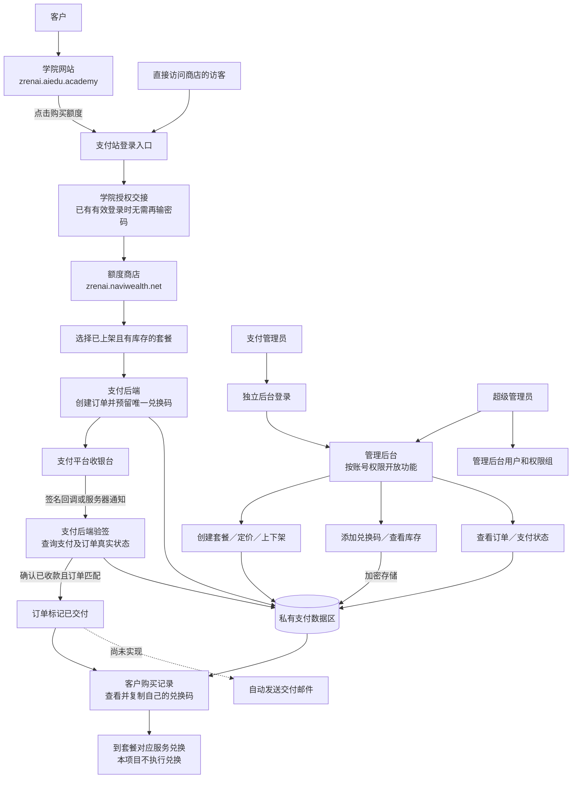
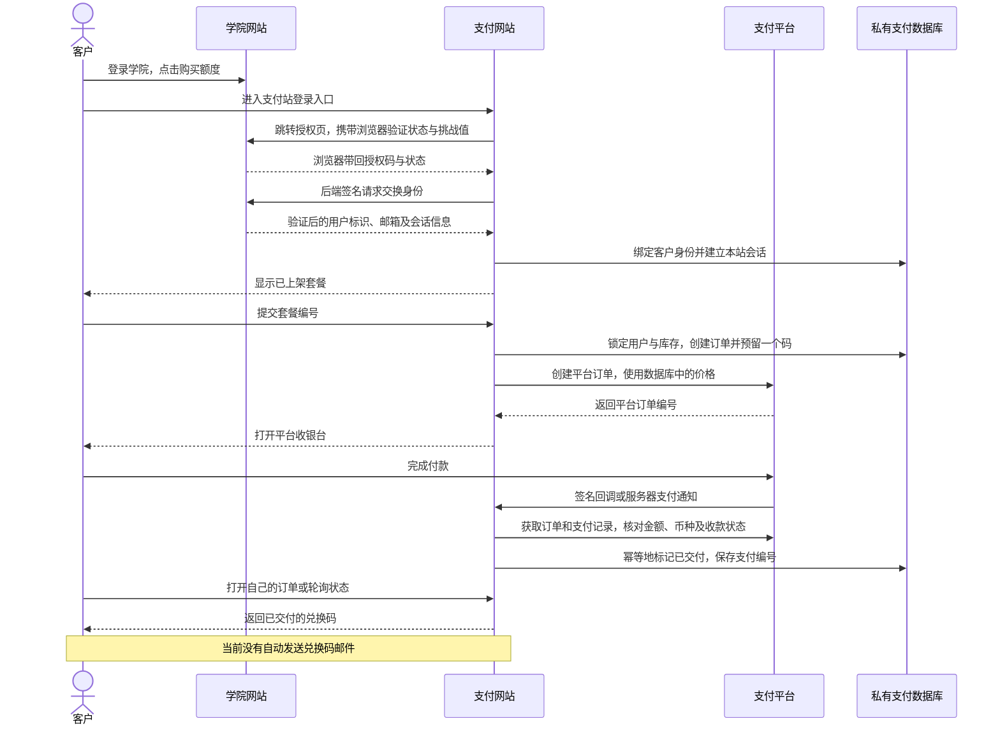
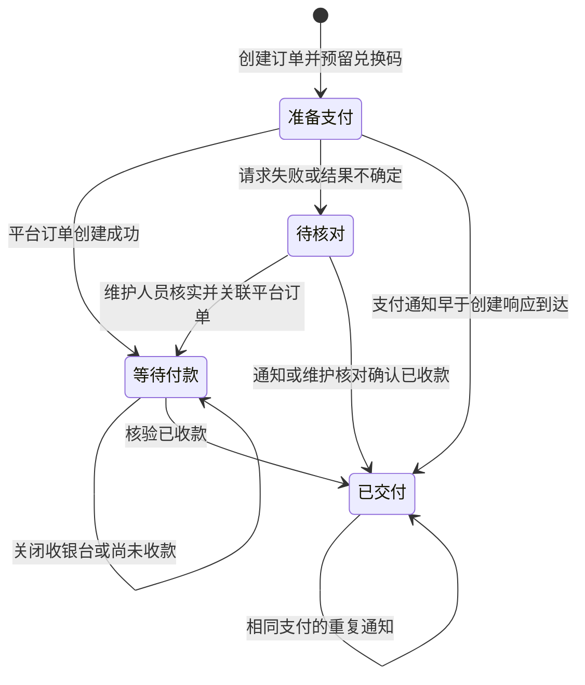
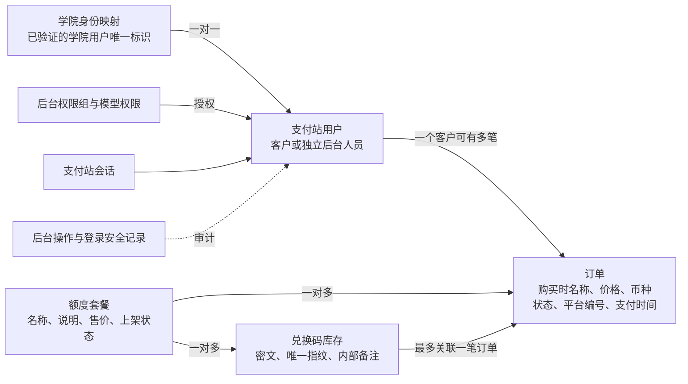

# 项目全景：路由、角色、数据与支付流程

核对日期：2026-10-21。依据当前本地源码与仓库部署说明编写，未重新核查线上部署、支付平台配置或实际人员权限。中文界面改动目前仅在本地。

## 一、项目边界与系统总图

- 学院入口：`https://zrenai.aiedu.academy`，负责学院账号、登录状态及课程服务。
- 支付商店：`https://zrenai.naviwealth.net`，负责套餐、兑换码库存、支付订单和交付。
- 本地预览：`http://127.0.0.1:8001`。当前使用本地数据库，与线上数据分开。
- 支付服务：Curlec，服务端调用其兼容的支付接口，浏览器打开平台收银台。
- 线上数据库：按仓库部署方案使用现有 Supabase 项目中的私有 `zrenai_payment` 数据区；支付后台通过数据库连接访问。
- 共用数据库项目不等于共用登录会话。跨域登录通过学院授权交接实现，支付端建立自己的会话和客户身份映射。



## 二、人员角色与权限

代码实际使用“是否登录、账号是否有效、是否为后台员工、是否为超级管理员、模型权限”判断访问权。套餐管理员、库存管理员、订单查看员是可配置的工作分工，**不是已自动创建并分配给人员的固定角色**。

| 角色／分工 | 登录方式 | 能做什么 | 权限边界 |
| --- | --- | --- | --- |
| 访客 | 尚未登录 | 进入登录页，通过学院完成登录 | 不能直接查看商店或订单；客户接口返回未登录状态 |
| 学院客户 | 学院授权交接 | 浏览套餐、购买、继续付款、查看自己的订单与已交付兑换码 | 不能查看其他客户订单；学院角色不会变成支付后台权限 |
| 学院管理员 | 使用学院身份进入支付站时仍按客户处理 | 与普通客户相同 | 不会因学院管理员身份获得支付后台访问权 |
| 套餐管理员（可配置） | 独立后台账号，需员工标记及套餐权限 | 按授权查看、新增、修改套餐和上下架 | 删除需要额外权限；已有订单／兑换码引用会阻止删除 |
| 库存管理员（可配置） | 独立后台账号，需兑换码权限 | 添加兑换码、查看库存和分配情况 | 查看兑换码详情会看到明文；现有记录只读，禁止后台删除 |
| 订单查看员（可配置） | 独立后台账号，需订单查看或修改权限 | 查看订单、支付状态、订单统计和平台编号 | 订单业务字段只读；不能手工新增、删除或改为已支付 |
| 超级管理员 | 独立后台账号 | 管理用户、权限组及全部已开放后台模块 | 仍受订单只读、兑换码禁止删除等业务规则限制 |
| 技术维护人员 | 服务器／部署维护权限 | 配置环境、迁移、备份、通过维护命令核对异常支付 | 这是运维权限，不是商店自动生成的人员角色；后台暂无核对按钮 |
| 支付平台（系统身份） | 签名验证，不使用客户账号 | 调用支付回调和服务器通知接口 | 必须通过签名与订单支付核验，不能直接读取库存 |

后台员工仅有员工标记仍不足以查看全部业务数据；管理概览按套餐、兑换码、订单权限分别显示统计和入口。授予用户／权限组管理权可能允许进一步授予权限，应视为账号管理职责。

## 三、完整业务路由表

下列路径属于支付网站；`<订单编号>` 在代码中是 UUID。

| 页面／接口 | 路径 | 方法 | 使用者与行为 |
| --- | --- | --- | --- |
| 商店首页 | `/` | GET | 已登录客户；访客跳转登录 |
| 登录页 | `/accounts/login/` | GET；本地登录模式接受 POST | 学院模式显示继续登录入口；关闭学院模式时使用本地账号表单 |
| 发起学院登录 | `/accounts/sso/start/` | GET | 保存浏览器验证状态，跳转学院授权页 |
| 学院登录返回 | `/accounts/sso/callback/` | GET | 验证返回状态并由后端交换身份，创建支付会话 |
| 退出支付站 | `/accounts/logout/` | POST | 清除本站会话；不会主动退出学院 |
| 本地注册 | `/accounts/signup/` | GET／POST | 仅学院登录关闭时可用；开启时跳回登录页 |
| 我的购买记录 | `/purchases/` | GET | 只列出当前客户订单；支持全部、处理中、已交付筛选 |
| 订单详情 | `/purchases/<订单编号>/` | GET | 只允许订单所属客户查看；交付后显示兑换码 |
| 创建或复用支付订单 | `/api/checkout/` | POST | 接收套餐编号；价格由服务端读取；需要登录与防伪令牌 |
| 查询订单状态 | `/api/orders/<订单编号>/` | GET | 仅订单所属客户；已交付时才返回兑换码 |
| 继续支付 | `/api/orders/<订单编号>/resume/` | POST | 仅订单所属客户；继续已有待付款订单，不再次分配码 |
| 支付跳转回调 | `/api/curlec/callback/<订单编号>/` | POST | 验证平台签名并查询支付真实状态，然后跳回受保护的订单详情 |
| 支付服务器通知 | `/api/curlec/webhook/` | POST | 验证原始请求签名，处理收款／订单支付事件并查询真实状态 |
| 静态资源 | `/static/…` | GET | 本地字体、样式、图标及页面脚本；无客户数据 |

学院端的配合路由由另一个项目实现；本项目源码确认会调用以下接口，但本次未重新审计学院项目：

| 学院路径 | 用途 |
| --- | --- |
| `/payments/authorize` | 接收支付站的授权请求，使用学院当前登录状态 |
| `/api/payment-sso/exchange` | 支付后端用一次性授权码交换经过验证的身份 |
| `/api/payment-sso/session` | 支付后端检查学院会话是否仍有效 |

## 四、后台路由与操作

后台由 Django 标准管理路由和自定义中文界面组成。所有业务管理页面均需要有效员工账号，且受相应模型权限限制。

| 页面 | 路径 | 开放操作 |
| --- | --- | --- |
| 后台概览 | `/admin/` | 按权限显示订单金额、库存、套餐和最近订单 |
| 后台登录 | `/admin/login/` | 独立管理员账号登录 |
| 后台退出 | `/admin/logout/` | 提交退出操作 |
| 修改自己的密码 | `/admin/password_change/` | 已登录管理员修改密码；完成页为 `/admin/password_change/done/` |
| 套餐列表 | `/admin/shop/product/` | 查看、筛选；按授权编辑／删除 |
| 新增套餐 | `/admin/shop/product/add/` | 名称、说明、售价、上架状态 |
| 编辑套餐 | `/admin/shop/product/<编号>/change/` | 修改套餐信息；历史订单保留购买时名称与价格 |
| 兑换码列表 | `/admin/shop/tokencode/` | 查看可用／已分配情况、按套餐筛选 |
| 添加兑换码 | `/admin/shop/tokencode/add/` | 选择套餐，录入一条唯一兑换码及可选内部备注 |
| 兑换码详情 | `/admin/shop/tokencode/<编号>/change/` | 只读查看明文、所属套餐、分配订单等信息 |
| 订单列表 | `/admin/shop/order/` | 查看、搜索、按状态和套餐筛选 |
| 订单详情 | `/admin/shop/order/<订单编号>/change/` | 业务字段只读；无手工创建或删除订单能力 |
| 用户管理 | `/admin/auth/user/` | 按授权管理支付站用户、员工标记、账号状态和权限 |
| 权限组管理 | `/admin/auth/group/` | 按授权配置权限组合 |
| 登录尝试 | `/admin/axes/accessattempt/` | 查看登录尝试、锁定情况；按授权执行安全维护 |
| 登录失败记录 | `/admin/axes/accessfailurelog/` | 查看失败记录 |
| 访问日志 | `/admin/axes/accesslog/` | 查看登录和退出记录 |

标准后台还提供模型操作历史 `/<编号>/history/`、删除确认 `/<编号>/delete/`、应用索引、关联对象选择、自动补全及脚本翻译等辅助路由。路由存在不代表允许执行：兑换码和订单删除被业务代码禁止；用户、组、套餐的新增／修改／删除依据各自权限开放。

## 五、客户登录与支付时序



普通客户访问支付站时，支付后端会向学院检查会话有效性。学院会话失效则要求重新登录；暂时无法验证时返回错误。后台和支付平台回调独立处理，不依赖客户此刻是否在线。

## 六、订单状态与库存规则



- 每笔订单预留一个兑换码，预留后立即退出可售库存；付款确认之前客户无法查看明文。
- 同一客户、同一套餐最多一笔未交付订单；重复发起购买会复用可继续付款的订单。
- 每位客户最多三笔未交付订单。
- 关闭收银台不会取消订单，也不会释放兑换码；当前没有自动取消／过期回收流程。
- 套餐下架或售罄后，已有待付款订单仍可继续支付。
- 只完成支付授权还不能交付，必须确认平台已经收款。
- 后台“已确认收款”按已交付订单金额汇总，不等于平台净结算或扣除退款后的财务收入。
- 异常核对通过 `manage.py reconcile_payment` 维护命令处理；不是管理员手动修改订单状态。

## 七、数据关系



客户身份以学院经过验证的唯一标识绑定，不通过邮箱匹配并合并管理员账号。兑换码使用独立密钥加密保存；后台获得兑换码查看权限的人可以在详情页读取明文。客户通过受保护的订单页面读取自己已付款订单的码，不直接访问数据库。

## 八、代码目录与责任

```text
项目根目录
├── gateway/
│   ├── urls.py                 页面、接口和后台路由入口
│   ├── settings.py             数据库、认证、中间件、语言和部署配置
│   └── wsgi.py                 应用运行入口
├── shop/
│   ├── sso.py                  学院授权交接、身份绑定、会话校验
│   ├── views.py                商店、购买记录、支付接口、回调与通知
│   ├── services.py             锁库存、创建订单、支付核验与交付
│   ├── curlec.py               支付平台请求和签名校验
│   ├── models.py               客户身份、套餐、兑换码、订单模型
│   ├── forms.py                注册与兑换码录入表单
│   ├── admin.py                管理字段、操作限制及权限入口
│   ├── admin_site.py           按权限显示管理概览与统计
│   ├── middleware.py          私有响应与缓存限制
│   ├── apps.py                 私有数据区检查与迁移后保护
│   ├── migrations/             数据结构与字段元数据迁移
│   ├── management/commands/    本地账号初始化、异常支付核对命令
│   └── test*.py                支付、登录、权限、并发和配置测试
├── templates/
│   ├── registration/          登录、注册、学院登录失败页面
│   ├── shop/                  商店、购买列表、订单详情
│   ├── admin/                 后台登录、导航与管理概览
│   └── ui/                    按钮、字段、卡片、表格、状态、弹窗等共享组件
├── static/
│   ├── ui/                    设计变量、共享组件、本地字体和图标
│   ├── artwork/               首页轮廓插画
│   ├── checkout.js            发起支付与收银台交互
│   └── purchase.js            查询交付状态与复制兑换码
├── locale/zh_Hans/            后台插件中文翻译
├── scripts/                   本地设置、隔离数据库和并发检查
└── docs/                      组件说明、预览截图与本架构文档
```

## 九、当前已有与尚未实现

| 功能 | 当前源码状态 |
| --- | --- |
| 学院账号免重复输入密码进入商店 | 已实现授权交接；需线上两端正确配置与有效学院会话 |
| 独立支付后台及分权限访问 | 已实现；具体人员／权限组需配置 |
| 套餐设置、上下架、兑换码录入 | 已实现；每次录入一条码，暂无批量导入界面 |
| 单次支付、服务器通知、订单内交付 | 已实现；不以本次源码检查代替真实支付验收 |
| 重复通知保护与库存唯一分配 | 已实现 |
| 中文商店与管理界面 | 本地已实现，尚未部署本次改动 |
| 支付后自动邮件发送兑换码 | **尚未实现**；未发现邮件发送代码、配置或任务 |
| 自动增加学院额度／代客户兑换 | **尚未实现**；此项目只出售并交付已有兑换码 |
| 循环订阅扣款 | **尚未实现**；当前是单次购买 |
| 自动退款、兑换码撤销、订单取消和库存回收 | **尚未实现**；需要独立业务流程 |

来源：`gateway/urls.py`、`shop/sso.py`、`shop/views.py`、`shop/services.py`、`shop/models.py`、`shop/admin.py`、`shop/admin_site.py`、`gateway/settings.py` 与仓库说明。本文不包含密码、签名密钥或兑换码。
